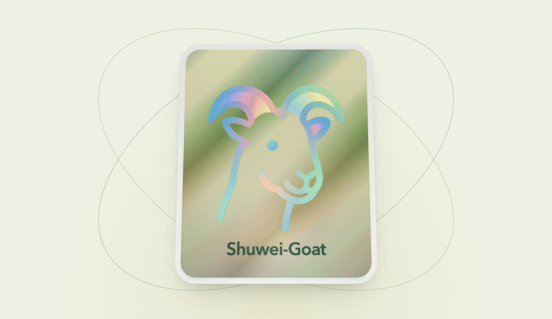
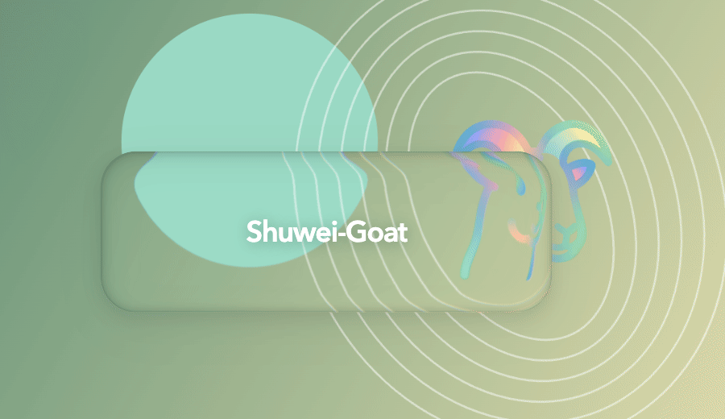
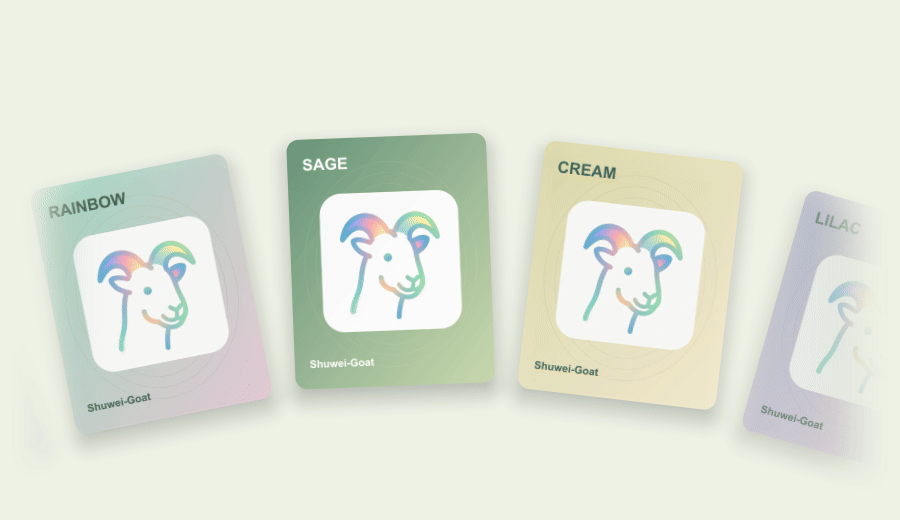

<picture>

</picture>

## PORTALS

**传送门**

<a href="https://github.com/Shuwei-Goat?tab=repositories"> 公开仓库 ↗</a>

个人网站 · **筹备中**

## QUEST BOARD

**项目**

<!-- PROJECTS:START -->
筹备中
<!-- PROJECTS:END -->

## SKILL INVENTORY

**Skills**

<!-- SKILLS:START -->
筹备中
<!-- SKILLS:END -->

## BUILD KIT

**本站搭建工具**

<picture>
  <source media="(prefers-color-scheme: dark)" srcset="assets/skills-dark.svg" />
  
</picture>

  

## SUMMARY CARDS

**数据卡片**

<picture>
  <source media="(prefers-color-scheme: dark)" srcset="profile/design/summary-profile-dark.svg" />
  
</picture>

<picture>
  <source media="(prefers-color-scheme: dark)" srcset="profile/design/summary-stats-dark.svg" />
  
</picture>
<picture>
  <source media="(prefers-color-scheme: dark)" srcset="profile/design/summary-languages-dark.svg" />
  
</picture>
<picture>
  <source media="(prefers-color-scheme: dark)" srcset="profile/design/summary-commits-dark.svg" />
  
</picture>
<picture>
  <source media="(prefers-color-scheme: dark)" srcset="profile/design/summary-time-dark.svg" />
  
</picture>

## CAPSULE RENDER

**渐变封面**

### Waving

<picture>
  
</picture>

### Rounded

<picture>
  
</picture>

### Blur

<picture>
  
</picture>

## REACT BITS

**角色与动态画廊**

[打开交互演示 ↗](https://shuwei-goat.github.io/Shuwei-Goat/)

### Profile Card

<picture>
  <source media="(prefers-reduced-motion: reduce)" srcset="assets/design/react-profile.png" />
  
</picture>

### Glass Surface

<picture>
  <source media="(prefers-reduced-motion: reduce)" srcset="assets/design/react-glass.png" />
  
</picture>

### Circular Gallery

<picture>
  <source media="(prefers-reduced-motion: reduce)" srcset="assets/design/react-gallery.png" />
  
</picture>
